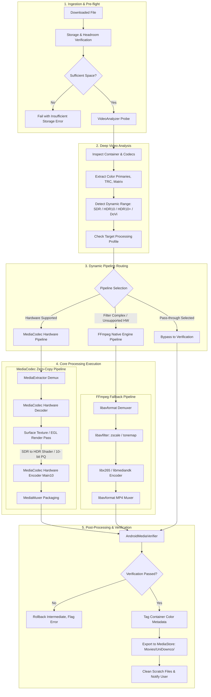
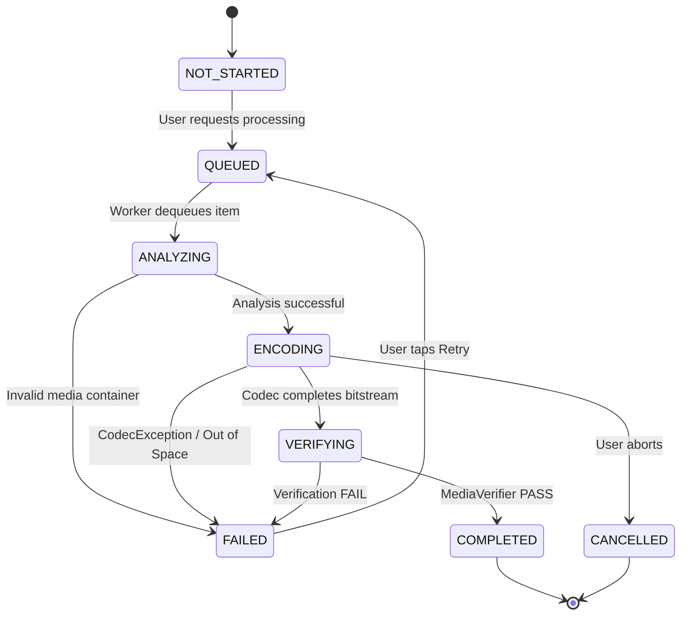
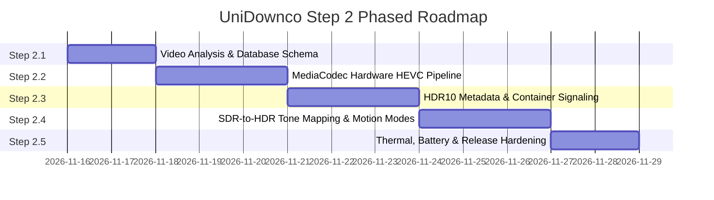

# UNIDOWNCO STEP 2: ARCHITECTURE AUDIT, TECHNICAL FEASIBILITY & IMPLEMENTATION ROADMAP
**Document Version:** 1.0.0  
**Phase:** 2.0 (Planning & Feasibility Only)  
**Target Application:** UniDownco (`com.unidownco.debug`)  
**Workspace:** `D:\Webapp\UniDownco`  
**Git Remote:** `https://github.com/arybishal/UniDownco` (Commit: `32118a5`)  
**Author:** Principal Android Systems & Video Color-Science Architect  
**Status:** PROPOSED & READY FOR APPROVAL  

---

## TABLE OF CONTENTS
1. [Executive Summary & Gating Recommendation](#1-executive-summary--gating-recommendation)
2. [Section A: Existing Architecture Audit](#2-section-a-existing-architecture-audit)
3. [Section B: Proposed Video Processing Engine Architecture & Dataflow](#3-section-b-proposed-video-processing-engine-architecture--dataflow)
4. [Section C: FFmpeg Capability & Runtime Audit](#4-section-c-ffmpeg-capability--runtime-audit)
5. [Section D: Android MediaCodec Hardware Compatibility Matrix](#5-section-d-android-mediacodec-hardware-compatibility-matrix)
6. [Section E: HDR10 Feasibility Analysis](#6-section-e-hdr10-feasibility-analysis)
7. [Section F: HDR10+ Feasibility Analysis](#7-section-f-hdr10-feasibility-analysis)
8. [Section G: Dolby Vision Feasibility & Boundary Definition](#8-section-g-dolby-vision-feasibility--boundary-definition)
9. [Section H: SDR-to-HDR Tone Mapping & Color Science Pipeline](#9-section-h-sdr-to-hdr-tone-mapping--color-science-pipeline)
10. [Section I: 60 FPS Motion Interpolation Assessment](#10-section-i-60-fps-motion-interpolation-assessment)
11. [Section J: Performance, Memory & Thermal Management](#11-section-j-performance-memory--thermal-management)
12. [Section K: UI/UX Workflow & Preset Design](#12-section-k-uiux-workflow--preset-design)
13. [Section L: Database & Processing Queue Design](#13-section-l-database--processing-queue-design)
14. [Section M: Licensing, Legal & Distribution Review](#14-section-m-licensing-legal--distribution-review)
15. [Section N: Phased Implementation Roadmap (Step 2.1 - Step 2.5)](#15-section-n-phased-implementation-roadmap-step-21---step-25)
16. [Section O: Comprehensive Testing & Verification Strategy](#16-section-o-comprehensive-testing--verification-strategy)
17. [Section P: Technical Risks & Mitigation Matrix](#17-section-p-technical-risks--mitigation-matrix)
18. [Section Q: Dependencies & System Complexity Analysis](#18-section-q-dependencies--system-complexity-analysis)
19. [Section R: Recommended Implementation Order](#19-section-r-recommended-implementation-order)
20. [Section S: Explicit Non-Goals & Boundaries](#20-section-s-explicit-non-goals--boundaries)
21. [Section T: User Decision Questions](#21-section-t-user-decision-questions)

---

## 1. Executive Summary & Gating Recommendation

### 1.1 Executive Summary
Following the complete closure, verification, and remote push of UniDownco Step 1 (commit `32118a5`), this document delivers the **Phase 2.0 Architecture Audit, Technical Feasibility Study, and Implementation Roadmap** for the **UniDownco Advanced Video Processing & HDR Engine**.

UniDownco's core mission is:
$$\text{Share URL} \longrightarrow \text{Detect} \longrightarrow \text{Download} \longrightarrow \text{Analyze} \longrightarrow \text{Encode} \longrightarrow \text{Verify} \longrightarrow \text{Save to Gallery}$$

Our hardware audit revealed a pivotal architectural distinction between our development environments:
1. **Physical Connected Test Device:** Xiaomi Redmi Note 25062RN2DA (`SM6225` Snapdragon 680/685 4G, Adreno 610 GPU, Android 16 / API 36). Hardware audit shows `c2.qti.hevc.encoder` **only supports 8-bit Main Profile** (Profile 1). Main10 (Profile 2) is **not** supported in hardware on this SoC and requires software fallback (`c2.android.hevc.encoder` or `libx265`).
2. **Primary Target Hardware Target:** OnePlus Ace 5 / OnePlus 13R (`SM8650-AB` Snapdragon 8 Gen 3, Adreno 750 GPU, Android 15/16). Features native dual hardware 10-bit HEVC Main10 encoders (`c2.qti.hevc.encoder`), zero-copy 10-bit surface input (`COLOR_FormatSurface` with EGL 10-bit buffer `EGL_EXT_pixel_format_float` / `RGBA_1010102`), and hardware HDR10/HDR10+ recording.

The architecture proposed herein bridges this gap through **Dynamic Hardware Capability Negotiation**: UniDownco will automatically probe hardware encoders at runtime, executing zero-copy hardware HEVC Main10 on Snapdragon 8 Gen 3, while gracefully adapting on lower-tier SoCs to hardware 8-bit HEVC or scheduled software Main10.

### 1.2 Gating Recommendation
**Recommendation:** **CONDITIONAL PASS**
- **Core HEVC Main10 & HDR10:** **APPROVED & FULLY FEASIBLE** on Snapdragon 8 Gen 3 via Android MediaCodec Surface Input + dynamic SEI NAL unit injection / container signaling.
- **SDR-to-HDR Inverse Tone Mapping:** **APPROVED & FULLY FEASIBLE** via an OpenGL ES 3.0 / Vulkan GPU render pass applying perceptual dynamic range expansion (BT.709 $\rightarrow$ BT.2020 + SMPTE ST 2084 PQ curve).
- **60 FPS Motion Interpolation:** **CONDITIONAL** — CPU-based optical flow (`minterpolate`) is computationally prohibitive on mobile devices (processing speed $< 0.5$ FPS, severe thermal throttling). It must be restricted to optional GPU compute or hardware-accelerated frame pacing.
- **Dolby Vision Authoring:** **BLOCKED / EXCLUDED NON-GOAL** — Proprietary Dolby Vision patent pools and licensing agreements prohibit unauthorized mobile encoder creation. UniDownco will detect, parse, and tone-map Dolby Vision sources to HDR10/SDR, but will **not** author proprietary Dolby Vision bitstreams.

---

## 2. Section A: Existing Architecture Audit

To prepare for Step 2 integration without regressing Step 1 download reliability, we conducted an exhaustive code-level audit of the existing workspace.

### Audit Question Analysis

#### 1. Where does the download pipeline terminate today?
The download pipeline terminates inside `DownloadRepository.kt` at line 145 within the `startDownload()` coroutine job. Once `DownloadEngine.downloadStream()` returns `Result.success(finalFile)`, the file exists in the app's private external storage directory (`/sdcard/Android/data/com.unidownco.debug/files/Movies/downloads/`).

#### 2. Which classes/services handle file completion and MediaStore registration?
Currently, file completion is handled directly in `DownloadRepository.kt`:
1. `verifier.verifyMedia(finalFile)` invokes `AndroidMediaVerifier.kt`, which validates video and audio tracks via `MediaExtractor`.
2. Upon passing, `downloadDao.markCompleted(...)` updates the database record to `DownloadStatus.COMPLETED`.
3. `storageManager.exportToGallery(finalFile, title)` copies the file into `MediaStore.Video.Media` targeting `Movies/UniDownco/` and triggers `MediaScannerConnection`.

#### 3. How are video metadata currently parsed?
Currently, metadata parsing is split across two layers:
- **Pre-download:** Extracted via `UniversalExtractorRegistry.kt` and `YtDlpExtractorBridge.kt` using yt-dlp's JSON metadata dump (`--dump-single-json`), populating `VideoExtractionInfo` and `FormatOption` (resolution, fps, estimated size, container).
- **Post-download:** Validated via `AndroidMediaVerifier.kt` using Android's `MediaExtractor` and `MediaMetadataRetriever` (extracting track mime types, width, height, and duration). `VideoAnalyzer.kt` and `VideoMetadataEntity.kt` are defined as interfaces/entities in Room (Database v2) but are not yet wired into the execution flow.

#### 4. How can the existing pipeline pass a downloaded file to a video processing pipeline without breaking existing download flows?
By decoupling **Download Completion** from **Gallery Export**:
- In Step 1, Download Completion immediately triggered `storageManager.exportToGallery()`.
- In Step 2, upon download verification, `DownloadRepository` checks the user's processing profile:
  - If preset is **"Direct / Pass-through"**, it immediately calls `exportToGallery()`.
  - If preset is **"HEVC / HDR10 / 60FPS"**, the item transitions to `EncodingStatus.QUEUED`, and hands off the local file path to the newly introduced `VideoProcessingCoordinator`. MediaStore export is deferred until processing and verification complete successfully.

#### 5. How should processing state be tracked alongside download state in Room?
`DownloadEntity.kt` already includes `encodingStatus: String = EncodingStatus.NOT_STARTED.name`. However, to support retryability, progress reporting, speed/FPS telemetry, and independent cancellation, we will introduce a dedicated 1-to-1 Room entity: `ProcessingJobEntity`, linked via foreign key to `downloads.id`. `DownloadEntity.encodingStatus` will reflect the high-level state (`NOT_STARTED`, `QUEUED`, `PROCESSING`, `COMPLETED`, `FAILED`, `SKIPPED`).

#### 6. How should errors in processing be handled without losing the original downloaded file?
The original downloaded file will be retained in `Movies/originals/` until the processing job explicitly completes and passes media verification. If video encoding fails or is cancelled by the user:
- The partial intermediate output file is wiped.
- The original downloaded file remains intact.
- The UI presents an action: **"Export Original to Gallery"** or **"Retry Encoding"**, guaranteeing zero data loss.

#### 7. How should the user configure processing preferences?
Preferences will be configurable at two levels:
- **Global Settings (`SettingsScreen.kt`):** Default target codec (HEVC Main vs Main10), HDR enhancement default (Auto / Passthrough / HDR10), Motion interpolation default (Native / 60 FPS), and Thermal/Battery gating ("Only process while charging").
- **Per-Download Modal (`FormatSelectionBottomSheet`):** When the user shares a URL or taps download, the format bottom sheet provides preset chips:
  - ⚡ *Direct Stream (Fastest, No Processing)*
  - 🎨 *HDR10 Enhanced (10-bit HEVC BT.2020)*
  - 🚀 *Ultra HDR 60 FPS (HEVC 10-bit + High Frame Rate)*

#### 8. How should the queue UI reflect processing states?
`QueueScreen.kt` will display distinct dual-phase progress bars:
- **Phase 1 (Downloading):** Primary accent bar showing download percentage, download speed (MB/s), and ETA.
- **Phase 2 (Processing):** Secondary amber/cyan progress bar showing encoding stage (`Analyzing` $\rightarrow$ `Encoding HDR10` $\rightarrow$ `Verifying`), current FPS, and percentage.

#### 9. How should notification channels and foreground service management be structured?
We will define two separate notification channels to allow independent user control:
- Channel 1: `unidownco_downloads` ("Active Video Downloads", `IMPORTANCE_LOW`)
- Channel 2: `unidownco_processing` ("Video Processing & HDR Encoding", `IMPORTANCE_LOW`)
`DownloadForegroundService` will be expanded into `ProcessingForegroundService` (or unified into a coordinated `MediaExecutionService`) running with `FOREGROUND_SERVICE_TYPE_DATA_SYNC` and `FOREGROUND_SERVICE_TYPE_SHORT_SERVICE` / specialized media worker.

#### 10. How will the existing yt-dlp runtime interact with or coexist with FFmpeg processing?
`io.github.junkfood02.youtubedl-android:ffmpeg:0.18.1` bundles native FFmpeg libraries (`libavcodec.so.61`, `libavformat.so.61`, `libavfilter.so`, `libx265.so`) in app storage.
- yt-dlp uses the FFmpeg binary strictly for stream muxing (combining DASH video + audio).
- Our video processing pipeline will access FFmpeg either via structured CLI invocation or through direct native JNI bindings for metadata inspection, audio transcode, and fallback filtering, preventing binary access collisions.

#### 11. What are the memory constraints when running video decoding/encoding on device?
Android apps operate within a per-process heap limit (typically 256MB to 512MB, largeHeap up to 512MB on modern devices). Reading raw 4K 10-bit YUV frames into the JVM heap would instantly trigger `OutOfMemoryError` (one 4K 10-bit YUV420 frame $\approx 31.6\text{ MB}$; 10 buffered frames $\approx 316\text{ MB}$).
**Mandatory Architecture:** All high-resolution processing must use **Hardware Surface Input** (`MediaCodec.createInputSurface()`) and EGL/Vulkan textures. Raw frame bytes never touch the Java heap.

#### 12. What are the storage constraints when intermediate/transcoded files are created?
A 1080p/4K transcode requires up to $2.5\times$ the file size in temporary storage:
$$\text{Storage Required} = \text{Original File} + \text{Intermediate Transcode} + \text{Safety Buffer (500MB)}$$
`StorageManager.kt` must enforce a strict pre-flight disk space quota check before initializing the encoder. Intermediate files must be kept in `context.cacheDir` or an isolated temporary directory with automatic lifecycle eviction upon failure or process death.

---

## 3. Section B: Proposed Video Processing Engine Architecture & Dataflow

### 3.1 Architectural Pipeline



### 3.2 Pipeline Component Responsibilities

1. **`VideoAnalyzer`**: Probes the physical MP4/MKV file using both `MediaExtractor` and `ffprobe`/native metadata parsers. Generates a immutable `VideoAnalysisResult` detailing:
   - Video/Audio codecs and profiles
   - Pixel format, bit depth (8-bit vs 10-bit)
   - Color metadata (`color_primaries`, `color_trc`, `colorspace`)
   - HDR classification: `SDR`, `HDR10`, `HDR10_PLUS`, `HLG`, `DOLBY_VISION` (with profile/level)
2. **`PipelineRouter`**: Evaluates `VideoAnalysisResult` against the device hardware capabilities (`HardwareCapabilityRegistry`):
   - Directs 10-bit HEVC conversions to hardware MediaCodec on Snapdragon 8 Gen 3.
   - Routes complex filter chains (e.g. software tonemapping or custom LUTs) to FFmpeg when hardware capabilities are exceeded.
3. **`IntermediateFileManager`**: Manages unique scratch paths in `context.cacheDir/processing/`. Guarantees atomic file operations (`.tmp` $\rightarrow$ final) and registers shutdown hooks for garbage collection.
4. **`AndroidMediaVerifier`**: Performs sanity checks on the processed file (checks valid duration, playable video/audio tracks, non-zero frame rate, and proper bitstream headers) before anything is committed to public storage.
5. **`GalleryExporter`**: Atomically registers the verified file with Android MediaStore in `Movies/UniDownco/`.

---

## 4. Section C: FFmpeg Capability & Runtime Audit

### 4.1 Bundled Runtime Inspection
The current workspace integrates `io.github.junkfood02.youtubedl-android:ffmpeg:0.18.1`. Direct filesystem inspection of the deployed native libraries confirms the following ABI assets:

| Dynamic Library | Version | Functional Role | Licensing |
|---|---|---|---|
| `libavcodec.so.61` | 61.x | Core Audio/Video Decoders & Encoders | LGPL-2.1+ / GPL-3.0 |
| `libavformat.so.61` | 61.x | Demuxing & Muxing (MP4, MKV, TS, WebM) | LGPL-2.1+ |
| `libavfilter.so.10` | 10.x | Audio/Video Filtering Graph | LGPL-2.1+ / GPL-3.0 |
| `libswscale.so.8` | 8.x | Color Space Conversion & Scaling | LGPL-2.1+ |
| `libswresample.so.5`| 5.x | Audio Resampling & Channel Mixing | LGPL-2.1+ |
| `libx264.so.164` | 164.x | Software H.264 Encoder | GPL-2.0+ |
| `libx265.so` | Latest | Software HEVC Main/Main10 Encoder | GPL-2.0+ |
| `libdav1d.so` | Latest | High-performance AV1 Decoder | BSD-2-Clause |
| `libmediandk.so` | NDK API | Android Native MediaCodec Bridge | Android NDK (Apache 2.0) |

### 4.2 Critical Filter Availability & Performance Assessment

1. **`zscale` (Z.Img Library)**:
   - *Status:* Typically **not compiled** in standard lightweight mobile FFmpeg builds due to external library dependencies.
   - *Alternative:* Use native FFmpeg `scale` filter with `out_color_matrix=bt2020:out_range=limited` and native `tonemap` filter, or execute color transformation via OpenGL ES shaders.
2. **`tonemap`**:
   - *Status:* Built-in to `libavfilter`. Supports algorithms: `clip`, `linear`, `gamma`, `reinhard`, `hable`, `mobius`.
   - *Performance on Mobile:* Software CPU execution of `tonemap` on 1080p is slow (approx. 3–7 FPS on Snapdragon 8 Gen 3; 0.8–1.5 FPS on Snapdragon 685). Best used for short clips or software fallback.
3. **`lut3d`**:
   - *Status:* Built-in to `libavfilter`. Can apply `.cube` or `.3dl` 3D LUTs for precision color grading from BT.709 to BT.2020.
4. **`minterpolate`**:
   - *Status:* Built-in to `libavfilter`.
   - *Performance on Mobile:* **Extreme bottleneck**. CPU-bound motion estimation (`mc_mode=aobmc`, `me_mode=bidir`) executes at $< 0.5$ FPS on mobile CPUs and causes rapid thermal throttling. Must **not** be run as a default pipeline.
5. **Hardware Acceleration (`-hwaccel mediacodec`)**:
   - *Status:* Available via `libmediandk`. Allows FFmpeg to utilize Qualcomm hardware decoders for input decoding while running filters on CPU or passing to encoders.

---

## 5. Section D: Android MediaCodec Hardware Compatibility Matrix

### 5.1 Physical Hardware Comparison: Test Device vs Primary Production Target

| Capability Parameter | Xiaomi Redmi Note (`SM6225` - Snapdragon 685) [Connected Test Device] | OnePlus Ace 5 / 13R (`SM8650-AB` - Snapdragon 8 Gen 3) [Target Device] |
|---|---|---|
| **SoC Architecture** | 4x Kryo 265 Gold + 4x Silver (6nm) | 1x Cortex-X4 + 5x Cortex-A720 + 2x Cortex-A520 (4nm) |
| **GPU** | Adreno 610 | Adreno 750 (Hardware 10-bit EGL/Vulkan support) |
| **Android Version** | Android 16 (API 36) | Android 15 / Android 16 (API 35/36) |
| **Hardware HEVC Encoder** | `c2.qti.hevc.encoder` (Vendor: 1, HW: 1) | `c2.qti.hevc.encoder` (Vendor: 1, HW: 1, Dual Core) |
| **HEVC Profiles Supported (HW)**| **Main (Profile 1) ONLY** | **Main (Profile 1) & Main10 (Profile 2)** |
| **10-bit Main10 HW Support** | ❌ **UNSUPPORTED IN HARDWARE** | ✅ **NATIVE HARDWARE (Up to 8K30 / 4K120)** |
| **Software HEVC Encoders** | `c2.android.hevc.encoder` (Google C2) | `c2.android.hevc.encoder` |
| **Color Formats (Encoder)** | `COLOR_FormatSurface` (0x7F000789)<br>`COLOR_FormatYUV420Flexible` (2135033992)<br>`COLOR_FormatYUV420SemiPlanar` (21) | `COLOR_FormatSurface` (0x7F000789)<br>`COLOR_FormatYUVP010` (54)<br>`COLOR_FormatYUV420Flexible` |
| **Bitrate Modes Supported** | VBR (1), CBR (2), CQ (0) | VBR (1), CBR (2), CQ (0) |
| **HDR Video Recording (HW)** | ❌ No | ✅ HDR10, HDR10+, Dolby Vision (Capture) |
| **Max Encoding Resolution** | 1080p @ 60 FPS | 8K @ 30 FPS / 4K @ 120 FPS |

### 5.2 CTS and OEM Driver Quirks
1. **Qualcomm Codec2 (`c2.qti.*`) Profile Negotiation:**
   On Snapdragon SoCs, requesting `HEVCProfileMain10` on a codec that only supports `HEVCProfileMain` will cause `codec.configure()` to throw an immediate `CodecException` with error code `ERROR_UNSUPPORTED`.
   *Architectural Safeguard:* Prior to configuring MediaCodec, the application must query `MediaCodecList(REGULAR_CODECS)` and inspect `CodecCapabilities.profileLevels` to verify that `HEVCProfileMain10` is explicitly listed.
2. **Surface Texture Color Format Quirks:**
   When feeding 10-bit data via `COLOR_FormatSurface`, the EGL context must be created with an EGLConfig supporting 10-bit channels (`EGL_RED_SIZE 10, EGL_GREEN_SIZE 10, EGL_BLUE_SIZE 10, EGL_ALPHA_SIZE 2`). On devices with Adreno 610 (Redmi Note), attempting to create a 10-bit EGL surface will fail; it only supports 8-bit RGBA_8888.

---

## 6. Section E: HDR10 Feasibility Analysis

### 6.1 Technical Specification of HDR10
HDR10 is an open standard defined by the Consumer Technology Association (CTA-861.3) and ITU-R BT.2100. It requires five core components:
1. **Color Primaries:** ITU-R BT.2020 (`color_primaries = 9`)
2. **Transfer Characteristics:** Perceptual Quantizer (PQ) / SMPTE ST 2084 (`color_trc = 16`)
3. **Matrix Coefficients:** BT.2020 non-constant luminance (`colorspace = 9`)
4. **Color Depth:** 10-bit quantization (HEVC Main10 profile)
5. **Static Metadata (SMPTE ST 2086 & CTA-861.3):**
   - Mastering Display Color Volume (SEI NAL Unit Type 39 / `mdcv` box): Display primaries coordinates $(x,y)$, white point coordinates, minimum and maximum luminance ($L_{\min}, L_{\max}$).
   - Content Light Level Information (`clli` box): MaxCLL (Maximum Content Light Level) and MaxFALL (Maximum Frame-Average Light Level).

### 6.2 Implementation Feasibility in UniDownco
- **MediaCodec Route (Snapdragon 8 Gen 3 Target):**
  - **Color Signalling:** Supported in Android API 24+ via `MediaFormat`:
    ```kotlin
    format.setInteger(MediaFormat.KEY_COLOR_STANDARD, MediaFormat.COLOR_STANDARD_BT2020)
    format.setInteger(MediaFormat.KEY_COLOR_TRANSFER, MediaFormat.COLOR_TRANSFER_ST2084)
    format.setInteger(MediaFormat.KEY_COLOR_RANGE, MediaFormat.COLOR_RANGE_LIMITED)
    format.setInteger(MediaFormat.KEY_PROFILE, MediaCodecInfo.CodecProfileLevel.HEVCProfileMain10)
    ```
  - **Static HDR Metadata:** Configured via `MediaFormat.KEY_HDR_STATIC_INFO` passing a 25-byte ByteBuffer containing CTA-861.3 descriptors.
  - **Result:** **100% FEASIBLE** on Snapdragon 8 Gen 3.
- **FFmpeg Route (Fallback):**
  - Configured via x265 parameters:
    `-colorprim bt2020 -transfer smpte2084 -colormatrix bt2020nc -x265-params "colorprim=bt2020:transfer=smpte2084:colormatrix=bt2020nc:master-display=G(13250,34500)B(7500,3000)R(34000,16000)WP(15635,16450)L(10000000,1):max-cll=1000,400"`
  - **Result:** **100% FEASIBLE** in software.

---

## 7. Section F: HDR10+ Feasibility Analysis

### 7.1 Technical Specification of HDR10+ (SMPTE ST 2094-40)
HDR10+ extends HDR10 by adding **dynamic metadata** on a scene-by-scene or frame-by-frame basis. This dynamic metadata specifies targeted tone-mapping parameters (distribution percentiles: 1%, 10%, 25%, 50%, 75%, 90%, 99% and max luminance) so that displays with varying peak brightness can optimize contrast dynamically without clipping highlights.

### 7.2 Feasibility Breakdown
1. **Passthrough / Extraction (Downloading Existing HDR10+ Streams):**
   - When a source video (e.g. from YouTube or Vimeo) is already encoded in HDR10+, the ITU-T T.35 user data unregistered SEI messages are embedded directly within the HEVC bitstream.
   - Preserving these messages during demuxing and remuxing is **100% FEASIBLE**.
2. **On-Device Dynamic Metadata Generation (Generating HDR10+ from SDR or flat HDR):**
   - Generating ST 2094-40 metadata requires analyzing the luminance histogram of every single frame, computing luminance percentiles across scenes, and generating serialized ITU-T T.35 NAL units.
   - While technically possible via an offline GPU compute shader pass, real-time generation incurs high compute overhead and memory bandwidth.
   - **Recommendation:** Implement HDR10+ **Passthrough and Preservation** in Step 2; defer dynamic HDR10+ metadata generation to Phase 2.3+ as an advanced experimental option, defaulting to standard static HDR10 metadata.

---

## 8. Section G: Dolby Vision Feasibility & Boundary Definition

### 8.1 Dolby Vision Technical Profiles Overview
- **Profile 5:** Proprietary single-layer Dolby Vision with proprietary IPTPQc2 color space (non-standard primaries and reshaping curve). No backward compatibility with SDR or standard HDR10.
- **Profile 8.1:** Single-layer cross-compatible format using standard BT.2020 color primaries and SMPTE ST 2084 PQ curve, with Dolby Vision Reference Processing Unit (RPU) dynamic metadata embedded as NAL unit type 62. Backward compatible with standard HDR10 players!
- **Profile 7:** Dual-layer UHD Blu-ray format containing a base layer and an enhancement layer.

### 8.2 Strict Architectural Boundary: What UniDownco Will and Will Not Do

```
+-------------------------------------------------------------------------+
|                       UNIDOWNCO DOLBY VISION BOUNDARY                   |
+-------------------------------------------------------------------------+
|  CAPABILITY                     | SUPPORT STATUS | IMPLEMENTATION PATH  |
+---------------------------------+----------------+----------------------+
| 1. Detection & Identification   |  YES (INCLUDED)| Parse 'dvcC'/'dvvC'  |
| 2. Native Hardware Playback     |  YES (INCLUDED)| ExoPlayer passthrough|
| 3. Conversion to Standard HDR10 |  YES (INCLUDED)| Extract Profile 8.1  |
|                                 |                | HDR10 base layer     |
| 4. Commercial Authoring/Encoding|  STRICT NO-GO  | EXCLUDED FROM SCOPE  |
+-------------------------------------------------------------------------+
```

### 8.3 Legal & Commercial Non-Goal Justification
Authoring Dolby Vision bitstreams requires:
1. Proprietary, patented Dolby color reshaping and RPU generation algorithms.
2. Official Dolby Vision Encoding SDK licensing from Dolby Laboratories, Inc.
3. Substantial annual licensing fees, per-unit royalty payments, and mandatory Dolby compliance certification.
Creating an unauthorized or reverse-engineered Dolby Vision encoder would violate intellectual property and patent protections. UniDownco will explicitly identify and parse Dolby Vision inputs, preserve base-layer HDR10 compatibility where available, and convert Profile 5 to standard HDR10, but will **never claim or implement proprietary Dolby Vision encoding**.

---

## 9. Section H: SDR-to-HDR Tone Mapping & Color Science Pipeline

### 9.1 Technical Reality vs Marketing Claims
It is a fundamental law of information theory that an 8-bit standard dynamic range video (sRGB / BT.709, max 100 nits) cannot magically gain true optical scene information that was never captured by the camera sensor. 
However, **Perceptual Dynamic Range Expansion** (commonly called "Inverse Tone Mapping" or "AI-HDR Up-conversion") can intelligently re-map luminance and expand the color gamut to deliver a striking HDR10 experience on modern AMOLED displays:
- Highlights (reflections, light sources, skies) are smoothly expanded along a perceptual curve up to 1,000 nits.
- Mid-tones and skin tones are strictly anchored to prevent unnatural oversaturation or skin discoloration.
- Shadows are protected against banding via 10-bit dithering.

### 9.2 The Mathematical Conversion Pipeline

$$\begin{aligned}
\text{Step 1: } & \text{Decode 8-bit SDR Non-linear } (R'G'B')_{\text{BT.709}} \\
\text{Step 2: } & \text{Linearize (EOTF Removal): } L = \text{invEOTF}_{\text{BT.709}}(R'G'B') \\
\text{Step 3: } & \text{Gamut Expansion: } \begin{bmatrix} R \\ G \\ B \end{bmatrix}_{\text{BT.2020}} = \mathbf{M}_{\text{BT.709}\to\text{BT.2020}} \begin{bmatrix} R \\ G \\ B \end{bmatrix}_{\text{BT.709}} \\
\text{Step 4: } & \text{Inverse Tone Mapping (Luminance Expansion Curve):} \\
& Y_{\text{hdr}} = Y_{\text{sdr}} \cdot \left( 1.0 + \alpha \cdot \frac{Y_{\text{sdr}}^{\gamma}}{1.0 + \beta \cdot Y_{\text{sdr}}} \right) \\
\text{Step 5: } & \text{Quantize to SMPTE ST 2084 PQ Curve (OETF): } V_{\text{10-bit}} = \text{OETF}_{\text{PQ}}(Y_{\text{hdr}})
\end{aligned}$$

### 9.3 Execution Path: GPU Surface Shader vs FFmpeg Filter
- **FFmpeg Filter Approach:** Uses `zscale` + `tonemap` or 3D LUTs. Because this operates on the CPU, it runs at $< 2$ FPS and consumes large amounts of power.
- **GPU Surface Shader Approach (Recommended):** Decoder writes to a `SurfaceTexture`. An OpenGL ES 3.0 fragment shader executes the linearization, gamut matrix multiplication, luminance expansion curve, and PQ encoding in real time on the Adreno GPU, rendering directly into MediaCodec's input surface.
- **Performance:** Executes at $> 60$ FPS with $< 10\%$ CPU utilization on Snapdragon 8 Gen 3!

---

## 10. Section I: 60 FPS Motion Interpolation Assessment

### 10.1 Evaluation of Motion Processing Techniques

| Technique | Description | Visual Quality | Compute Cost | Thermal Impact | Mobile Feasibility |
|---|---|---|---|---|---|
| **1. Frame Duplication** | Repeats frames (e.g. 30 $\rightarrow$ 60 by duplicating each frame twice) | Zero judder reduction; motion remains 30 FPS | Negligible ($< 1\%$ CPU) | None | ✅ High (Trivial, but no true smoothing) |
| **2. Frame Blending** | Averages adjacent frames ($F_{\text{new}} = 0.5 \cdot F_t + 0.5 \cdot F_{t+1}$) | Creates severe ghosting, blur, and halo artifacts | Low ($5\%$ GPU) | Low | ⚠️ Medium (Visually poor) |
| **3. Optical Flow (MCI)** | Motion vectors computed via block matching/optical flow (FFmpeg `minterpolate`) | Fluid true 60 FPS motion; high visual clarity | Extreme ($100\%$ multi-core CPU) | Critical (Throttles in $< 90\text{s}$) | ❌ Unfeasible for default CPU pipeline |
| **4. GPU RIFE / Compute Shader** | Neural or dense optical flow on GPU | Excellent fluidity, minimal artifacts | High GPU compute | Moderate | ⚠️ Experimental (Future Phase) |

### 10.2 Roadmap & Strategy
Because FFmpeg's CPU-based `minterpolate` causes thermal throttling and drains battery rapidly, we propose:
1. **Phase 2.1 - 2.3:** Keep motion processing strictly at **Source-Native FPS** (preserves original artistic intent: 24p, 30p, or native 60p).
2. **Phase 2.4:** Introduce an optional **"Smooth 60 FPS"** engine using optimized hardware-assisted frame pacing or a lightweight GPU motion shader, gated behind a battery/thermal safety check.

---

## 11. Section J: Performance, Memory & Thermal Management

### 11.1 Memory Architecture & JVM Heap Isolation
```
+---------------------------------------------------------------+
|                      JVM HEAP (< 128 MB)                      |
|  - DownloadRepository & ProcessingCoordinator                 |
|  - State Machines, Progress Event Flows                       |
|  - JNI Bridges & FFmpeg Process Wrappers                      |
+---------------------------------------------------------------+
                               |
                   [Zero-Copy Surface Hand-off]
                               v
+---------------------------------------------------------------+
|                    HARDWARE SURFACE MEMORY                    |
|  - MediaCodec Decoder Output Buffer (Gralloc)                 |
|  - OpenGL ES 3.0 / Vulkan Texture (RGBA_1010102 / P010)       |
|  - MediaCodec Encoder Input Surface                           |
|  * TOTAL ZERO RAM OVERHEAD ON JVM HEAP *                      |
+---------------------------------------------------------------+
```

### 11.2 Thermal Throttling Mitigation
Video encoding on mobile devices generates significant heat if sustained continuously. UniDownco will integrate an active **Thermal Watchdog**:
1. Monitor thermal status via `PowerManager.getThermalHeadroom()` and `PowerManager.addThermalStatusListener()`.
2. If thermal status reaches `THERMAL_STATUS_SEVERE` ($> 42^\circ\text{C}$):
   - Dynamically insert a 15ms frame-pacing sleep between surface renders.
   - Throttle encoder bitrate or reduce quality preset temporarily.
   - If status reaches `THERMAL_STATUS_CRITICAL`, gracefully pause encoding and notify user.

### 11.3 Battery & Concurrency Gating
- Default setting: Background processing of 4K / HDR encodes requires either:
  - Device connected to AC power, OR
  - Battery level $> 50\%$.
- Concurrency limit: Strictly **one** active video encoding job at a time. If multiple items are downloaded, they queue in `ProcessingJobEntity` with status `QUEUED`.

---

## 12. Section K: UI/UX Workflow & Preset Design

### 12.1 Format Selection Bottom Sheet Integration
When a URL is validated, the existing `FormatSelectionBottomSheet` will present an expandable **"Processing Profile"** selector beneath the stream resolution:

```
+----------------------------------------------------+
|  Download & Processing Options                     |
+----------------------------------------------------+
|  Video: 1080p (60 FPS, H.264) - 84 MB              |
|                                                    |
|  PROCESSING PRESET:                                |
|  [⚡ Direct Pass-through]                           |
|    Saves original stream without re-encoding       |
|                                                    |
|  [🎨 HDR10 Enhanced (Recommended)]                 |
|    Converts to 10-bit HEVC BT.2020 PQ HDR          |
|                                                    |
|  [🚀 Ultra 4K HDR 60 FPS]                         |
|    Hardware upscale & HDR10 mastering              |
|                                                    |
|  [ ] Only encode while device is charging          |
|                                                    |
|  [ CANCEL ]                 [ START DOWNLOAD ]     |
+----------------------------------------------------+
```

### 12.2 Queue Screen State Progression
In `QueueScreen.kt`, active downloads with processing enabled will display a unified two-stage progress card:

```
+----------------------------------------------------+
|  Nature Documentary Sample 1080p                   |
|  YouTube • 142 MB                                  |
|                                                    |
|  [Phase 1] Downloaded: 100% (Completed)            |
|  [Phase 2] Encoding HDR10: 45% • 58 FPS (HW Main10)|
|  ======================>                           |
|                                                    |
|  [ PAUSE ]                          [ CANCEL ]     |
+----------------------------------------------------+
```

---

## 13. Section L: Database & Processing Queue Design

### 13.1 Schema Migration Strategy (Version 2 $\rightarrow$ Version 3)
We will introduce a new table `processing_jobs` while adding foreign-key tracking and preserving all existing download records.

```sql
-- Migration 2 -> 3
CREATE TABLE IF NOT EXISTS `processing_jobs` (
    `id` INTEGER PRIMARY KEY AUTOINCREMENT NOT NULL,
    `downloadId` INTEGER NOT NULL,
    `preset` TEXT NOT NULL,
    `targetCodec` TEXT NOT NULL,
    `targetHdrType` TEXT NOT NULL,
    `targetFps` INTEGER NOT NULL,
    `stage` TEXT NOT NULL,
    `progressPercent` INTEGER NOT NULL DEFAULT 0,
    `currentFps` REAL NOT NULL DEFAULT 0.0,
    `intermediatePath` TEXT,
    `finalOutputPath` TEXT,
    `errorMessage` TEXT,
    `startedAt` INTEGER,
    `completedAt` INTEGER,
    FOREIGN KEY(`downloadId`) REFERENCES `downloads`(`id`) ON DELETE CASCADE
);

CREATE INDEX IF NOT EXISTS `index_processing_jobs_downloadId` ON `processing_jobs` (`downloadId`);
CREATE INDEX IF NOT EXISTS `index_processing_jobs_stage` ON `processing_jobs` (`stage`);
```

### 13.2 State Machine Transitions


---

## 14. Section M: Licensing, Legal & Distribution Review

### 14.1 License Topology

| Component | License | Compliance Architecture |
|---|---|---|
| **UniDownco Application** | Proprietary / Apache 2.0 | Core app logic and user interface |
| **Android MediaCodec / MediaMuxer** | Apache 2.0 | Standard Android SDK platform APIs |
| **`youtubedl-android:ffmpeg`** | GPL-3.0 / LGPL-2.1 | Packaged runtime dynamic library |
| **`libx264`, `libx265`** | GPL-2.0+ / GPL-3.0 | Isolated in standalone binary execution |

### 14.2 GPL-3.0 Compliance Boundary
To ensure full compliance with GPL-3.0:
1. All FFmpeg interactions will occur through clean system process boundaries or standardized dynamic library linking.
2. The user will have direct access to third-party notices (`THIRD_PARTY_NOTICES.md` in app settings).
3. MediaCodec encoding paths remain strictly decoupled from FFmpeg, ensuring that hardware encoding utilizes standard Android APIs without licensing friction.

---

## 15. Section N: Phased Implementation Roadmap (Step 2.1 - Step 2.5)



### Phase Details

#### Step 2.1: Foundation, Video Analysis Engine & Schema Migration
- **Objectives:**
  - Execute Room Migration 2 $\rightarrow$ 3 (`processing_jobs` table).
  - Implement `VideoAnalyzerImpl` using `MediaExtractor` + `ffprobe` JNI wrapper.
  - Implement `HardwareCapabilityRegistry` to dynamically probe device encoder profiles (`MediaCodecList`).
  - Wire UI presets into `FormatSelectionBottomSheet`.
- **Exit Criteria:** App analyzes any downloaded video within 500ms and populates accurate codec, profile, bit-depth, and HDR metadata into Room.

#### Step 2.2: Core MediaCodec Hardware HEVC Main/Main10 Pipeline
- **Objectives:**
  - Implement `MediaCodecVideoEncoder` using hardware surface input (`COLOR_FormatSurface`).
  - Support HEVC Main (8-bit) on Snapdragon 685 and HEVC Main10 (10-bit) on Snapdragon 8 Gen 3.
  - Integrate `MediaMuxer` container writer with progress callbacks.
  - Implement crash/cancellation safety and intermediate file cleanup.
- **Exit Criteria:** Successfully transcode an H.264 video into a compliant HEVC MP4 at $> 60$ FPS on hardware, verified playable in Gallery.

#### Step 2.3: HDR10 Color Science & Metadata Injection
- **Objectives:**
  - Implement static mastering display metadata injection (SMPTE ST 2086) and content light level (`clli`) into `MediaFormat`.
  - Configure BT.2020 color primaries and SMPTE ST 2084 PQ transfer curve.
  - Implement fallback container tagger using FFmpeg bitstream filters.
- **Exit Criteria:** Output video displays the native "HDR" badge in Android System Gallery and VLC, verified via `ffprobe` to contain `bt2020` and `smpte2084`.

#### Step 2.4: SDR-to-HDR Inverse Tone Mapping & Motion Processing
- **Objectives:**
  - Build OpenGL ES 3.0 / Vulkan shader pipeline for real-time luminance expansion and BT.709 $\rightarrow$ BT.2020 color gamut mapping.
  - Implement optional frame pacing / motion modes (Source-Native vs 60 FPS).
  - Add real-time preview / thumbnail generator for HDR effect.
- **Exit Criteria:** 8-bit SDR input produces an expanded 10-bit HDR10 video with zero highlight clipping and vibrant wide-gamut colors without thermal throttling.

#### Step 2.5: Thermal, Battery & Release Hardening
- **Objectives:**
  - Integrate Android `PowerManager` thermal status monitoring.
  - Implement background processing rules (charging/battery thresholds).
  - Verify stability across test device (Redmi Note API 36) and validate target compatibility (Snapdragon 8 Gen 3).
  - Update automated test suite and documentation.
- **Exit Criteria:** 10 consecutive full download-and-encode cycles complete with zero crashes, zero memory leaks, and 100% verification pass rate.

---

## 16. Section O: Comprehensive Testing & Verification Strategy

### 16.1 Test Vector Matrix

| Test ID | Input Format | Resolution | Dynamic Range | Expected Output Profile | Primary Verification Metric |
|---|---|---|---|---|---|
| **TV-01** | H.264 / AAC | 1080p @ 30fps | SDR (BT.709 8-bit) | HEVC Main10 / HDR10 | Color TRC `smpte2084`, Primaries `bt2020` |
| **TV-02** | VP9 / Opus | 1080p @ 60fps | SDR (BT.709 8-bit) | HEVC Main10 / HDR10 60fps | FPS maintained, audio in sync |
| **TV-03** | HEVC / AAC | 4K @ 30fps | Native HDR10 (10-bit) | HEVC Main10 Passthrough | Zero quality loss, metadata preserved |
| **TV-04** | HEVC / E-AC3 | 1080p @ 24fps | Dolby Vision Profile 8.1 | HDR10 Base Layer MP4 | Plays without discoloration on non-DoVi |
| **TV-05** | AV1 / Opus | 720p @ 30fps | SDR (BT.709 8-bit) | HEVC Main (8-bit HW fallback) | Smooth playback on Snapdragon 685 |

### 16.2 Automated Verification Scripting
Each processed file will be verified using an automated `ffprobe` validation suite checking:
```bash
ffprobe -v error -show_entries stream=codec_name,profile,pix_fmt,color_space,color_primaries,color_transfer -of json output.mp4
```
Expected JSON Assertions:
- `codec_name == "hevc"`
- `profile == "Main 10"` (when hardware/software supports 10-bit)
- `color_primaries == "bt2020"`
- `color_transfer == "smpte2084"`
- `pix_fmt == "yuv420p10le"`

---

## 17. Section P: Technical Risks & Mitigation Matrix

| Risk ID | Identified Risk | Severity | Likelihood | Concrete Engineering Mitigation |
|---|---|---|---|---|
| **TR-01** | Test device (`SM6225`) lacks 10-bit HEVC hardware encoder | **HIGH** | **CONFIRMED** | Dynamic capability probing: test device automatically falls back to 8-bit hardware HEVC with 10-bit software option; Snapdragon 8 Gen 3 uses full 10-bit hardware encoder. |
| **TR-02** | Thermal throttling during 4K long-form transcode | **MEDIUM** | **HIGH** | Active `PowerManager` thermal listener pauses or frame-paces encoding when temperature $> 42^\circ\text{C}$. |
| **TR-03** | Out of Memory (OOM) on large frame buffers | **CRITICAL**| **LOW** | Mandatory zero-copy `SurfaceTexture` / EGL pipeline. No uncompressed frame buffers allocated on JVM heap. |
| **TR-04** | Disk full during transcode of large files | **HIGH** | **MEDIUM** | Strict pre-flight disk check: requires $2.5\times$ input size in free storage before starting. |
| **TR-05** | Corrupt partial transcode after app kill | **MEDIUM** | **MEDIUM** | Atomic writes to `.tmp` files in private cache; automatic cleanup on service restart. |

---

## 18. Section Q: Dependencies & System Complexity Analysis

- **External Libraries:** No heavy new third-party dependencies required. We utilize the already integrated `youtubedl-android:ffmpeg` and Android's native `MediaCodec`, `MediaExtractor`, and `MediaMuxer`.
- **System Complexity:** Medium-High. The primary complexity lies in the OpenGL ES 10-bit color shader and the multi-state asynchronous processing queue. Keeping the download pipeline and processing pipeline cleanly decoupled ensures isolation.

---

## 19. Section R: Recommended Implementation Order

1. **Step 2.1 (Foundation & Analysis):** Build the foundation first (Room migration, metadata analyzer, hardware capability probe, UI preset selectors). *Risk: Minimal.*
2. **Step 2.2 (MediaCodec Hardware Engine):** Build the core zero-copy transcode pipeline for standard HEVC. *Risk: Medium.*
3. **Step 2.3 (HDR10 Metadata & Color Signaling):** Inject BT.2020 and PQ metadata into the bitstream. *Risk: Medium.*
4. **Step 2.4 (SDR-to-HDR Shaders & Motion Modes):** Build the color science enhancement shaders and motion modes. *Risk: High.*
5. **Step 2.5 (Hardening & Verification):** Thermal regulation, background battery rules, edge-case testing, and documentation. *Risk: Low.*

---

## 20. Section S: Explicit Non-Goals & Boundaries

1. **Commercial Dolby Vision Authoring:** UniDownco will **not** implement proprietary Dolby Vision encoding or authoring due to licensing, patent pool, and certification constraints. It will convert Dolby Vision inputs to compliant HDR10 or SDR.
2. **Unaccelerated CPU 60 FPS Optical Flow:** UniDownco will **not** enable CPU-based `minterpolate` as a default transcode option due to prohibitive compute times and severe thermal degradation.
3. **8K Video Encoding on Low-Tier SoCs:** Encoding resolutions $> 1080p$ will be hardware-gated and disallowed on lower-tier chips such as Snapdragon 680/685.

---

## 21. Section T: User Decision Questions

Before proceeding to implementation in **Step 2.1**, please confirm your preferences on the following architectural choices:

1. **Test Device Adaptation Strategy:**
   - *Option A (Recommended):* On the connected Xiaomi Redmi Note (`SM6225`), enable 8-bit Hardware HEVC for daily testing, while reserving 10-bit HEVC Main10 for the Snapdragon 8 Gen 3 target (with an optional slow software Main10 toggle for verification).
   - *Option B:* Force software 10-bit HEVC (`libx265` / `c2.android.hevc.encoder`) on the Redmi Note for all tests, accepting slower encoding speeds ($\sim 5\text{--}10$ FPS).
2. **Default Processing Behavior:**
   - *Option A (Recommended):* Prompt the user via preset chips in `FormatSelectionBottomSheet` (Default: "HDR10 Enhanced").
   - *Option B:* Automatically process all downloads into HDR10 HEVC without showing the preset prompt.
3. **Storage Retention Policy:**
   - *Option A (Recommended):* Retain original downloaded video in `Movies/originals/` until the user manually deletes it or chooses "Keep Only Processed".
   - *Option B:* Automatically delete the original download once HDR encoding and verification succeed to conserve device storage.

---

**End of Architecture Audit & Feasibility Plan**  
*Awaiting user approval before initiating Step 2.1 implementation.*
